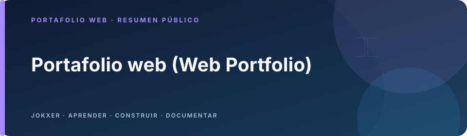

<h1 align="center"></h1>

### Una experiencia digital que reúne distintas áreas de interés

**Diseño, identidad personal y desarrollo web en evolución.**

[🌐 Visitar el sitio](https://jokxer.dev/)

## El proyecto

Un portafolio web personal que conecta el perfil profesional, los intereses creativos y varios proyectos en una experiencia adaptable. La propuesta combina una identidad visual propia para cada área con componentes organizados para seguir creciendo.

## Áreas

| Área | Contenido |
| --- | --- |
| 👤 Personal | Presentación e intereses |
| 💼 Profesional | Habilidades y proyectos |
| 🎮 Videojuegos | Juegos y publicaciones |
| ⚽ Deporte | Trayectoria y formación |
| ✉️ Contacto | Canales de comunicación |

## Diseño y tecnología

La interfaz utiliza secciones independientes, navegación adaptable a móviles, animaciones moderadas y una paleta que distingue cada área. El desarrollo emplea tecnologías actuales de frontend, entre ellas React y TypeScript.

## Estado del proyecto

| Estado | Trabajo |
| --- | --- |
| 🟢 Publicado | Sitio disponible para explorar |
| 🟡 En desarrollo | El contenido y la experiencia siguen evolucionando |
| ⚪ Próximo | Mejoras de accesibilidad, contenido y funcionalidades |

## Transparencia

Este repositorio presenta el proyecto en términos generales. El código fuente y la documentación de implementación se mantienen en un repositorio privado. Los estados describen el avance general y no representan una auditoría técnica completa.
