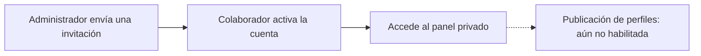

<h1 align="center"></h1>

### Jokxer.dev: diseño web y evolución del portafolio

Conoce el sitio publicado y el alcance del módulo privado Jokxer Collaborators.

[🌐 Sitio](https://jokxer.dev/) · [🎨 Diseño](#diseño-y-tecnología) · [👥 Collaborators](#jokxer-collaborators) · [🧪 Evidencia](docs/jokxer-collaborators/MILESTONES.md)

## El proyecto

Un portafolio web personal que conecta el perfil profesional, los intereses creativos y varios proyectos en una experiencia adaptable. La propuesta combina una identidad visual propia para cada área con componentes organizados para seguir creciendo.

## De un vistazo

| 🌐 Sitio público | 👥 Collaborators | 🧪 Evidencia |
|---|---|---|
| [jokxer.dev](https://jokxer.dev/) | Panel privado; sin perfiles públicos | [Hitos y alcance de las pruebas](docs/jokxer-collaborators/MILESTONES.md) |

## Áreas

| Área | Contenido |
| --- | --- |
| 👤 Personal | Presentación e intereses |
| 💼 Profesional | Habilidades y proyectos |
| 🎮 Videojuegos | Juegos y publicaciones |
| ⚽ Deporte | Trayectoria y formación |
| ✉️ Contacto | Canales de comunicación |

## Diseño y tecnología

La interfaz utiliza secciones independientes, navegación adaptable a móviles, animaciones moderadas y una paleta que distingue cada área. El desarrollo emplea tecnologías actuales de frontend, entre ellas React y TypeScript.

## Estado del proyecto

| Estado | Trabajo |
| --- | --- |
| 🟢 Publicado | Sitio disponible para explorar |
| 🟡 En desarrollo | El contenido y la experiencia siguen evolucionando |
| ⚪ Próximo | Mejoras de accesibilidad, contenido y funcionalidades |

## Transparencia

Este repositorio presenta el proyecto en términos generales. El código fuente y la documentación de implementación se mantienen en un repositorio privado. Los estados describen el avance general y no representan una auditoría técnica completa.

---

## Jokxer Collaborators

**Jokxer Collaborators** es un módulo privado en desarrollo dentro de jokxer.dev para que colaboradores invitados administren un perfil profesional. Las cuentas se crean por invitación y cualquier publicación futura quedará bajo control administrativo.

**Estado documentado:** Fase 2 implementada según el informe técnico; se observó el panel privado con una cuenta de prueba activa. Las pruebas de seguridad de base de datos, typecheck, lint y build fueron reportadas como satisfactorias. **Queda pendiente probar la suspensión de una cuenta**, incluida la revocación de la sesión y el bloqueo de reingreso y operaciones directas. Se registró la recepción y activación de una invitación de prueba. La recuperación de acceso por correo y la prueba de suspensión siguen pendientes. El módulo no está abierto al público y aún no publica perfiles.

- [Presentación y estado](docs/jokxer-collaborators/README.md)
- [Hitos y evidencias](docs/jokxer-collaborators/MILESTONES.md)
- [Arquitectura](docs/jokxer-collaborators/ARCHITECTURE.md)
- [Seguridad](docs/jokxer-collaborators/SECURITY.md)
- [Hoja de ruta](docs/jokxer-collaborators/ROADMAP.md)
- [Registro de cambios](docs/jokxer-collaborators/CHANGELOG.md)

**Nivel:** sitio publicado; módulo de colaboradores **implementado en entorno privado**. Hay [evidencia de 3 de 5 flujos de prueba](docs/jokxer-collaborators/MILESTONES.md#flujos-de-prueba). El siguiente hito es comprobar recuperación de acceso y suspensión.

### Flujo de acceso

El código y los procedimientos internos permanecen en el repositorio privado. No se incluyen secretos ni datos de cuentas. El trabajo utiliza infraestructura existente, con presupuesto adicional de USD 0.
